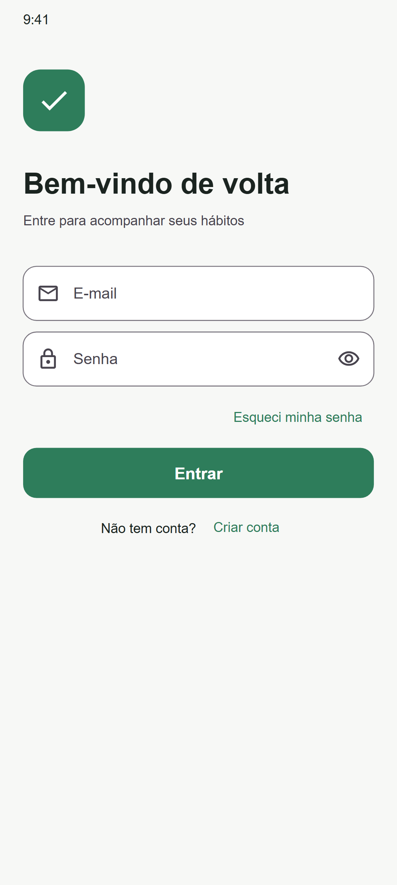
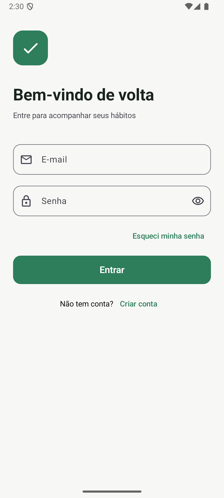
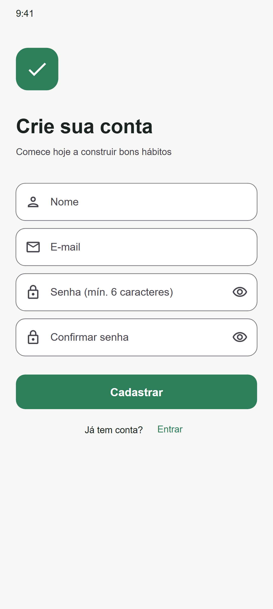
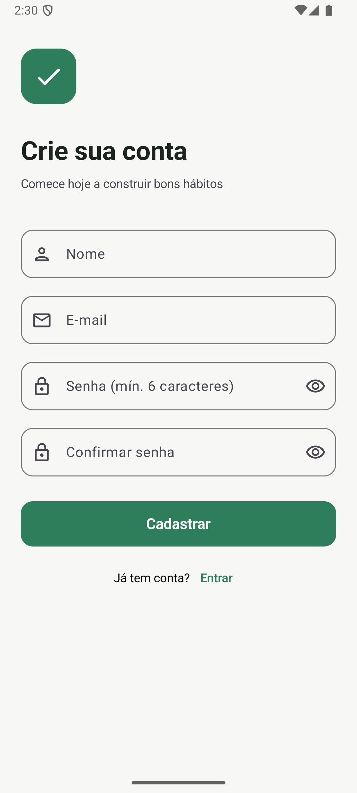
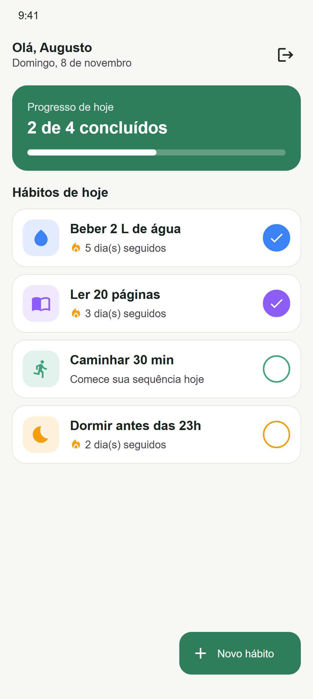
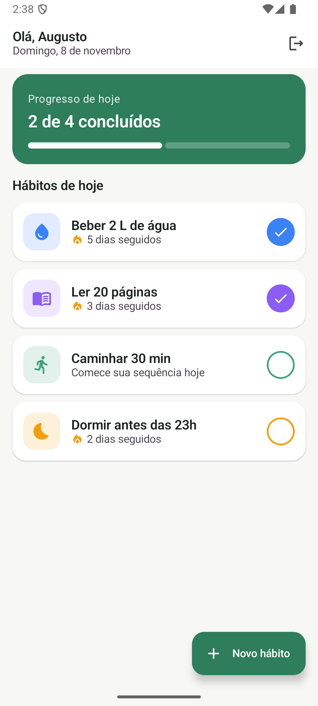
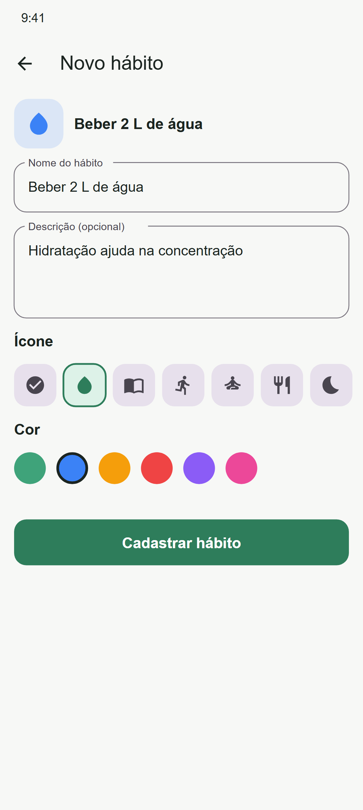
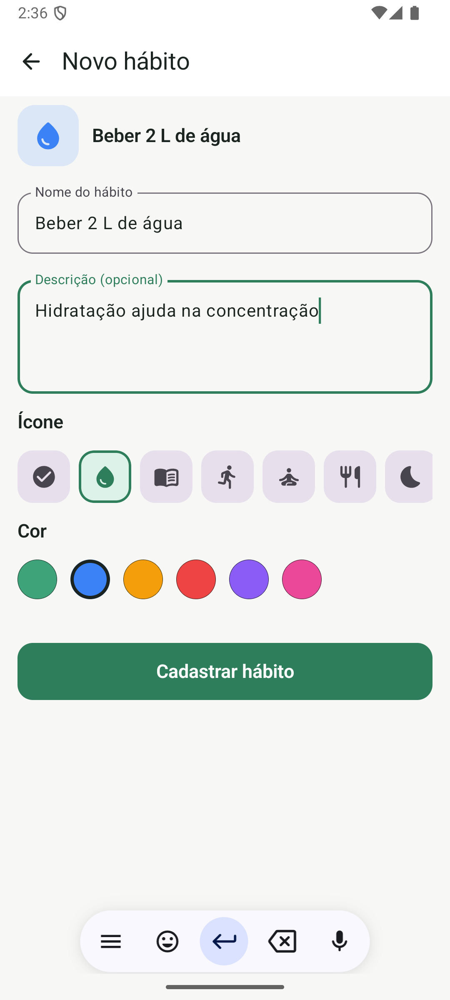
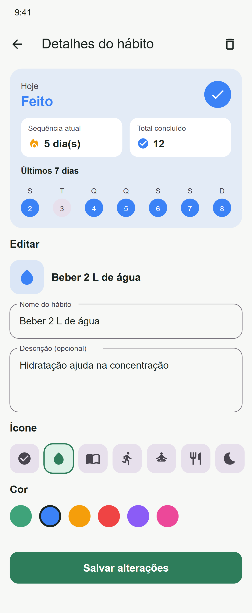
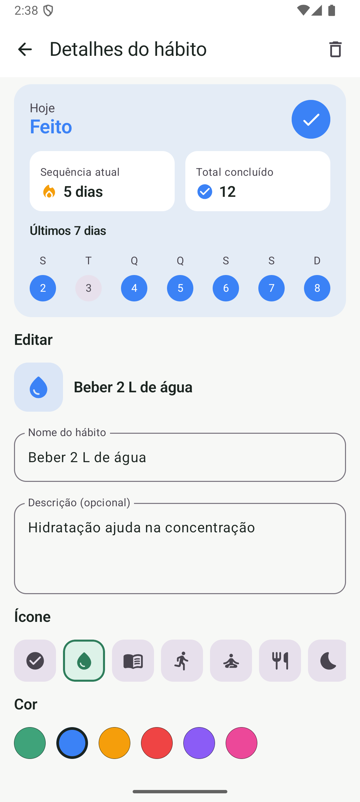

# Habit Tracker

Aplicativo Android de controle de hábitos desenvolvido em Kotlin com Jetpack Compose. O projeto segue a arquitetura MVVM, usa o Firebase Authentication para login com e-mail e senha e salva os hábitos localmente com Jetpack DataStore.

Prova 04 da disciplina Programação para Dispositivos Móveis (TADS, IFTM).
Aluno: Augusto Alex Caixeta Silva

## Protótipo no Figma

Link público: https://www.figma.com/design/W5vTyNYTPERp2hFkB3MzGa/Habit-Tracker?node-id=0-1

O protótipo contém os seguintes fluxos:

- Login e registro
- Listagem de hábitos com o progresso do dia
- Cadastro, edição e detalhes de um hábito

## Funcionalidades

- Registro de conta com nome, e-mail e senha, com validação dos campos e confirmação de senha
- Login com e-mail e senha
- Recuperação de senha por e-mail
- Sessão persistente: se o usuário já estiver autenticado, o app abre direto na listagem
- Listagem de hábitos com um resumo do progresso do dia
- Marcação do status diário (feito ou não feito) direto na listagem
- Cadastro de hábito com nome, descrição, ícone e cor
- Tela de detalhes com status do dia, sequência atual, total de conclusões e histórico dos últimos 7 dias
- Edição e exclusão de hábitos
- Logout com confirmação
- Hábitos separados por usuário
- Tema claro e escuro

## Requisitos

| Item | Versão |
|---|---|
| Android Studio | Versão recente com suporte a AGP 8.7 |
| JDK | 17 ou superior (o JDK embutido no Android Studio funciona) |
| Android mínimo | 8.0 (API 26) |
| compileSdk / targetSdk | 35 |
| Kotlin | 2.0.21 |
| Android Gradle Plugin | 8.7.3 |

## Build e execução

### 1. Clonar o repositório

```bash
git clone https://github.com/augustocaixeta/habit-tracker-android.git
cd habit-tracker-android
```

### 2. Configuração do Firebase

O arquivo `app/google-services.json` do projeto Firebase usado no desenvolvimento já está no repositório, então o build funciona sem configuração adicional.

Para usar um projeto Firebase próprio:

1. Crie um projeto no [Console do Firebase](https://console.firebase.google.com/).
2. Adicione um app Android com o nome de pacote `br.edu.iftm.habittracker`.
3. Baixe o `google-services.json` e substitua o arquivo em `app/`.
4. Em Authentication, na aba Método de login, ative o provedor E-mail/senha.

### 3. Executar

Pelo Android Studio:

1. Abra a pasta do projeto e aguarde a sincronização do Gradle.
2. Selecione um emulador ou aparelho com Android 8.0 ou superior.
3. Clique em Run.

Pela linha de comando, com um emulador aberto ou aparelho conectado:

```bash
./gradlew installDebug
```

No Windows, use `gradlew.bat installDebug`.

## Arquitetura MVVM

### Estrutura de pastas

```
app/src/main/java/br/edu/iftm/habittracker/
├── HabitTrackerApp.kt              Application que cria os repositórios
├── MainActivity.kt                 Ponto de entrada, aplica o tema e a navegação
├── data/                           Model
│   ├── Habit.kt                    Entidade Habit, ícones e regras (feito hoje, sequência, total)
│   ├── AuthRepository.kt           Acesso ao Firebase Authentication
│   └── HabitRepository.kt          CRUD e status diário com DataStore
└── ui/                             View e ViewModel
    ├── auth/
    │   ├── AuthViewModel.kt        StateFlow<AuthUiState>
    │   └── AuthScreens.kt          LoginScreen e RegisterScreen
    ├── habits/
    │   ├── HabitListViewModel.kt   StateFlow<HabitListUiState>
    │   ├── HabitListScreen.kt      Listagem e marcação de feito/não feito
    │   ├── HabitFormViewModel.kt   StateFlow<HabitFormUiState>
    │   ├── HabitFormScreen.kt      Cadastro, edição e detalhes
    │   ├── HabitComponents.kt      Botão de feito e ícone do hábito
    │   └── HabitIcons.kt           Conversão de HabitIcon em ícone Material
    ├── navigation/
    │   ├── Routes.kt               Rotas tipadas com @Serializable
    │   └── HabitNavHost.kt         Grafo de navegação
    └── theme/
        └── Theme.kt                Cores, tipografia e Material 3
```

Os textos da interface ficam em `res/values/strings.xml`, e o código usa apenas `stringResource`.

### Responsabilidades

| Camada | Responsabilidade | Arquivos |
|---|---|---|
| Model | Representa os dados e as regras de negócio. Os repositórios são o único ponto de acesso ao Firebase e ao DataStore. | `data/` |
| ViewModel | Mantém o estado da tela em um `StateFlow`, valida as entradas e chama os repositórios dentro do `viewModelScope`. Sobrevive a mudanças de configuração, como a rotação da tela, e não depende de Compose. | `*ViewModel.kt` |
| View | Funções `@Composable` que exibem o estado recebido com `collectAsStateWithLifecycle()` e repassam os eventos do usuário (cliques e digitação) ao ViewModel. Não contêm regra de negócio. | `*Screen.kt` |

O Model não conhece nenhuma classe de interface. O ícone de um hábito, por exemplo, é o enum `HabitIcon`, e a conversão para o ícone do Material Icons acontece na camada de UI, em `HabitIcons.kt`. Da mesma forma, os erros de autenticação chegam à tela como o enum `AuthFormError`, e a tela escolhe o texto correspondente no `strings.xml`.

Os repositórios são criados uma única vez na classe `HabitTrackerApp`. Cada ViewModel tem uma `Factory` que busca os repositórios nessa classe, sem biblioteca de injeção de dependência.

### Fluxo de estado

O fluxo de dados é unidirecional:

```
  View  ──── evento ────▶  ViewModel  ──── chamada suspend ────▶  Repository
   ▲                          │                                       │
   └──── novo estado ─────────┘◀────────── Flow com os dados ─────────┘
```

Exemplo ao marcar um hábito como feito:

1. O usuário toca no círculo do hábito na `HabitListScreen`.
2. A tela chama `viewModel.toggleDone(id)`.
3. O `HabitListViewModel` chama `habits.toggleDone(userId, id)`, que adiciona ou remove a data de hoje e grava no DataStore.
4. O DataStore emite a lista atualizada pelo `Flow`. O ViewModel converte essa lista em um novo `HabitListUiState` com `map` e `stateIn`.
5. A tela observa o `StateFlow` e é recomposta com o novo status e o progresso atualizado.

### Persistência do status diário

Cada hábito guarda o conjunto `completedDates` com as datas em que foi concluído, no formato ISO (`"2026-11-07"`). O hábito está feito hoje quando a data atual está nesse conjunto. A mesma estrutura permite calcular a sequência de dias e montar o histórico da semana.

Os hábitos são serializados em JSON e salvos no Preferences DataStore, em uma chave por usuário (`habits_<uid>`). Assim, duas contas no mesmo aparelho não compartilham os mesmos hábitos.

## Integração com o Firebase Authentication

### Dependências

- Plugin `com.google.gms.google-services`, que lê o `google-services.json`
- `firebase-bom` e `firebase-auth`
- `kotlinx-coroutines-play-services`, que permite usar `.await()` nas `Task` do Firebase

### AuthRepository

Toda a comunicação com o Firebase fica na classe `AuthRepository`, que usa `FirebaseAuth.getInstance()`. Os ViewModels dependem dessa classe e não acessam o Firebase diretamente.

| Ação | Método do Firebase |
|---|---|
| Registro | `createUserWithEmailAndPassword()` seguido de `updateProfile()` para salvar o nome |
| Login | `signInWithEmailAndPassword()` |
| Recuperação de senha | `sendPasswordResetEmail()` |
| Logout | `signOut()` |
| Verificação de sessão | `currentUser` |

As funções do repositório são `suspend` e retornam `Result<T>`. Quando uma chamada falha, o repositório lança uma `AuthException` com o enum `AuthError`, identificado pelo tipo da exceção (`FirebaseNetworkException`, `FirebaseTooManyRequestsException`) ou pelo código de erro do Firebase (`ERROR_EMAIL_ALREADY_IN_USE`, `ERROR_INVALID_CREDENTIAL`, `ERROR_WEAK_PASSWORD` e outros). O `AuthViewModel` converte esse motivo em um `AuthFormError`, e a tela exibe a mensagem correspondente do `strings.xml`.

### Redirecionamento após o login

Quando o login ou o registro termina com sucesso, o `AuthViewModel` altera o campo `isLoggedIn` do estado para `true`. O `HabitNavHost` observa esse valor e navega para a rota `Habits`, removendo as telas de autenticação da pilha. Com isso, o botão voltar não retorna ao login.

Ao abrir o app, se `currentUser` não for nulo, a listagem é definida como tela inicial.

O `uid` do usuário autenticado é usado como chave de armazenamento dos hábitos.

## Comparação entre o Figma e o app

| Tela | Figma | App |
|---|---|---|
| Login |  |  |
| Registro |  |  |
| Listagem |  |  |
| Cadastro |  |  |
| Detalhes |  |  |

## Tecnologias

- Kotlin 2.0
- Jetpack Compose com Material 3
- ViewModel e StateFlow
- Navigation Compose
- DataStore Preferences
- Firebase Authentication
- Kotlin Coroutines
